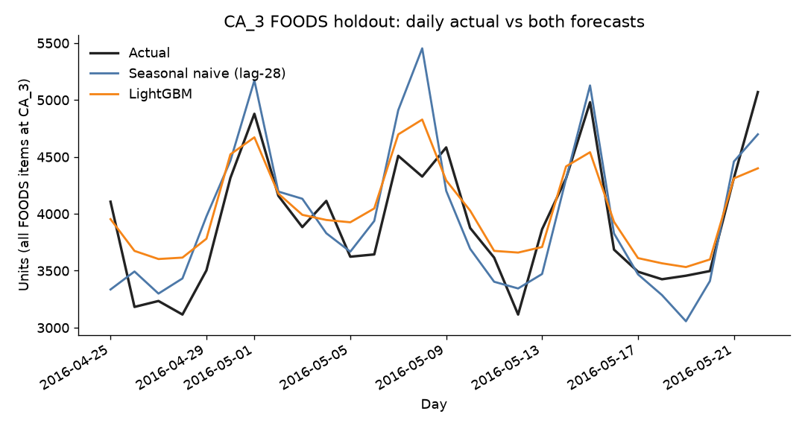

# Demand Forecasting — Walmart M5

## Start here

Read the files in the order below. It mirrors the order in which the work was actually done — the story first, the evidence for each stage next, and the code last — because a forecast is only as persuasive as the reasoning that precedes it.

1. This README, which states the question and the result.
2. [data/README.md](data/README.md), then [data/raw/README.md](data/raw/README.md), which explain where the data came from and where the downloads belong.
3. [reports/01-plan.md](reports/01-plan.md), which argues for food at CA_3, the 28-day test and the choice of measures.
4. [reports/02-analyze.md](reports/02-analyze.md), best read with these charts open: [monthly trend](images/ca_monthly_trend.png), [weekday pattern](images/ca_weekday_seasonality.png), [volume by store and category](images/ca_volume_by_store_and_category.png), [SNAP by category](images/ca_snap_by_category.png).
5. [reports/03-construct.md](reports/03-construct.md), alongside [forecast vs actual](images/ca3_foods_forecast_vs_actual.png), [daily error](images/ca3_foods_daily_error.png) and the scores in [ca3_foods_metrics.csv](data/processed/ca3_foods_metrics.csv).
6. [reports/ca3_foods_one_item_forecast.xlsx](reports/ca3_foods_one_item_forecast.xlsx), where a single item (FOODS_3_090) is worked by hand in Excel.
7. [reports/04-execute.md](reports/04-execute.md), then [reports/business-report.md](reports/business-report.md), which carry the recommendation and the manager's version of it.
8. [dashboards/ca3_foods_dashboard.html](dashboards/ca3_foods_dashboard.html), the one-page dashboard; download it and open it in a browser.
9. [src/analyze_ca.py](src/analyze_ca.py), then [src/construct_forecast.py](src/construct_forecast.py), the code itself. Its `#` comments are written to be read next to reports 2 and 3.

The remaining files in [data/processed/](data/processed/) are small tables produced by the analyze step. None of them needs to be opened on its own; each is worth a look only when a report refers to it.

## Executive summary

**Business question.** How many food units will Walmart store CA_3 sell, item by item, over the next 28 days — and does LightGBM beat the humble alternative of copying the same weekday from four weeks earlier?

**Result.** The holdout runs from 2016-04-25 through 2016-05-22 and spans 1,437 FOODS series, 40,236 item-days and 109,870 actual units. On it, LightGBM's WAPE is **64.9%**, against **77.7%** for the lag-28 seasonal naive. MAPE, measured only on days with actual sales, tells the same story: 56.3% versus 87.8%. That said, the win is not clean. Both forecasts run high, LightGBM by +2.6% and lag-28 by +1.1%, and a high forecast translates into extra inventory rather than stockouts. LightGBM, in short, wins on WAPE and MAPE; it loses on bias.

**Recommendation.** Use LightGBM for CA_3 food replenishment planning, and keep the lag-28 forecast as its benchmark. Dollar savings should not be claimed; after all, no dollar figure was ever calculated.

**Not in this result.** Other stores, HOUSEHOLD, HOBBIES and inventory policy, the last of which belongs to project 02, all fall outside this result. Note, moreover, that the aggregate win does not extend to every item. On FOODS_3_090, which accounts for 250,502 training units and 3,357 holdout units, the baseline WAPE of 0.1975 beats LightGBM's 0.2130.

## Reports, chart, and code

| | |
|---|---|
| Plan | [reports/01-plan.md](reports/01-plan.md) |
| Analyze | [reports/02-analyze.md](reports/02-analyze.md) |
| Construct | [reports/03-construct.md](reports/03-construct.md) |
| Execute | [reports/04-execute.md](reports/04-execute.md) |
| Business report | [reports/business-report.md](reports/business-report.md) |
| Chart | [images/ca3_foods_forecast_vs_actual.png](images/ca3_foods_forecast_vs_actual.png) |
| Dashboard | [dashboards/ca3_foods_dashboard.html](dashboards/ca3_foods_dashboard.html) (open the file; GitHub will show the source) |
| Code | [src/analyze_ca.py](src/analyze_ca.py), [src/construct_forecast.py](src/construct_forecast.py) |

The dashboard is a static HTML page, which means it opens anywhere without a login. Publishing to Tableau Public remains a manual step — one that requires importing `data/processed/ca3_foods_holdout_predictions.csv` — given that this repo was never signed into Tableau.

## Data
The source, license and file inventory are documented in [`data/README.md`](data/README.md).

## Approach (PACE: Plan, Analyze, Construct, Execute)
- **Plan:** [reports/01-plan.md](reports/01-plan.md). This stage fits no model; it fixes the decisions every later stage must live with.
  - **Scope:** California only, across stores CA_1, CA_2, CA_3 and CA_4. M5 spans three states and ten stores, yet four California stores are enough to reveal store differences while remaining small enough to run on a laptop.
  - **Horizon:** the next 28 days, which is M5's official forecast horizon of four weeks.
  - **Target:** daily unit sales, as recorded in the evaluation series, rather than dollar sales.
  - **Grain:** the forecast is made at item–store–day and then rolled up, bottom-up, to category–store–week for the executive view.
  - **Holdout:** the last 28 days of `sales_train_evaluation`, 2016-04-25 through 2016-05-22; everything before that is training data.
  - **Baseline:** a seasonal naive that copies the same weekday four weeks earlier (lag-28). Retail demand repeats weekly, and a forecast made 28 days ahead cannot use actuals inside its own horizon; the baseline respects both facts.
  - **Stronger model:** LightGBM on lag and calendar features, including price, SNAP and events. Prophet serves only as a category-level check, given that it is too slow to run at item grain.
  - **Metrics:** MAPE and bias, the latter defined as mean forecast minus actual, as a percent of actual. A volume-weighted MAPE is added so that no tiny item can dominate. Given that MAPE explodes whenever actual is 0, WAPE (sum of absolute errors / sum of actuals) or a denominator floor is reported alongside it, together with the share of zero-sales days.
  - **Why accuracy matters:** forecast error ultimately becomes units of safety stock. A forecast biased high inflates inventory, while one biased low causes stockouts. This stage establishes the direction of that effect only — it attaches no dollar figures.
  - **Out of scope:** inventory optimization, which is project 02; causal promotion experiments; and all 10 stores.
  - **Excel:** one category in one store, comparing the seasonal naive with a simple Excel forecast — for interviewers who would rather open a spreadsheet than a script.
- **Analyze:** [reports/02-analyze.md](reports/02-analyze.md). These are descriptive checks on CA_1–CA_4 alone, produced by `src/analyze_ca.py`; no model is fit.
  - **Shape:** the data hold 12,196 item–store series, 3,049 items in each store, running from `d_1` 2011-01-29 through `d_1941` 2016-05-22. Missing cells number 0. Zero-sale cells, by contrast, number 15,621,951 of 23,672,436, a share of 0.6599215644727058. The validation file matches the evaluation file on `d_1`–`d_1913`, with 0 mismatched cells.
  - **Weekday:** Sunday averages 18,507.230215827338 CA units per day, while Wednesday averages 12,947.335740072202. The statewide daily total correlates at 0.8408696097678586 at lag 7 and at 0.84399231729513 at lag 28, which means the lag-28 baseline keeps the weekly pattern intact.
  - **SNAP:** `snap_CA` is on for the 1st–10th of each month, 640 days in all. Statewide average daily units reach 15,823.4234375 on SNAP days against 14,657.74481168332 otherwise, a lift of 0.07952646473197889. The lift is sharpest in FOODS, at 0.1024460777606011, and far smaller in HOUSEHOLD, at 0.03620140269117922, and HOBBIES, at 0.02992724013488668.
  - **Volume and intermittency:** CA_3 accounts for 11,363,540 units, a share of 0.3892060877940489, and FOODS for 19,535,863, a share of 0.6691116333387758. Moreover, 9,145 of 12,196 series sell on fewer than half of days — precisely why MAPE needs the zero-day rule from the plan.
  - **Price and first cut:** 2,660,038 of 3,390,488 CA item–store–weeks carry a price, a share of 0.7845590369291973. The other 730,450 weeks all fall before an item's first price and contain 0 units, and there are 0 interior price holes. Construct should therefore prove the pipeline on FOODS at CA_3, with its 7,625,660 units, before scaling to all 12,196 series.
- **Construct:** [reports/03-construct.md](reports/03-construct.md). The scope narrows deliberately to FOODS at CA_3, 1,437 series, over a 28-day horizon with holdout `d_1914`–`d_1941` (2016-04-25 through 2016-05-22); training labels stop at `d_1913`. The script is `src/construct_forecast.py`. The seasonal naive is lag-28, drawn from the 28 days before the holdout. LightGBM is direct multi-step, using lags 28/35/42, rolling means ending at lag 28, weekday, month, `snap_CA`, an event flag and that week's price; it uses no lags 1–27, which would not exist at forecast time. The holdout scores below are ratios, not percents; MAPE is computed only where actual > 0, and WAPE is the volume-weighted score.
  - Seasonal naive: MAPE 0.8781250159967809, WAPE 0.777000091016656 and bias 0.010694457085646673, from a sum of absolute error of 85369.0, a sum of forecast−actual of 1175.0 and a sum of actual of 109870.0.
  - LightGBM: MAPE 0.5633893484087068, WAPE 0.6490765893903951 and bias 0.02570857287913414, from a sum of absolute error of 71314.04487632272 and a sum of forecast−actual of 2824.600902230468.
  - LightGBM beat the baseline on WAPE and MAPE, and on WAPE it won every weekday. That said, it did not win on bias: both forecasts are high, and LightGBM is the higher of the two. On the highest-volume training item, FOODS_3_090, with 250,502 units on `d_1`–`d_1913`, the baseline WAPE is actually lower (0.1974977658623771 vs LightGBM 0.2129970073026922). The workbook is `reports/ca3_foods_one_item_forecast.xlsx`, and the chart is `images/ca3_foods_forecast_vs_actual.png`. No dollar figure is attached.
- **Execute:** [reports/04-execute.md](reports/04-execute.md) and [reports/business-report.md](reports/business-report.md). Nothing is refit at this stage. The recommendation is to use LightGBM for CA_3 food replenishment planning, keep lag-28 as the benchmark, and refrain from claiming dollar savings. WAPE stands at 64.9% for LightGBM against 77.7% for lag-28. Both forecasts are high, by +2.6% and +1.1% respectively, which means extra inventory rather than stockouts. The dashboard is [dashboards/ca3_foods_dashboard.html](dashboards/ca3_foods_dashboard.html). Tableau Public was not published, although the predictions CSV can be imported by hand for that purpose.

## Key Findings
- On FOODS at CA_3, over the holdout 2016-04-25 through 2016-05-22, LightGBM posts a WAPE of **64.9%** against **77.7%** for lag-28. MAPE, restricted to actual > 0, falls from 87.8% to 56.3%, and absolute error drops from 85,369 units to 71,314.04487632272 units, on 109,870 actual units.
- Both forecasts are high, with bias at +2.6% for LightGBM and +1.1% for lag-28. A high bias means extra inventory, not a stockout risk; moreover, LightGBM is the more high of the two.
- About 66% of California item-days are zeros, which means MAPE cannot serve as the headline. WAPE does.
- The exception matters: on FOODS_3_090, the baseline WAPE of 0.1975 beats LightGBM's 0.2130.

## Recommendation
Use LightGBM for CA_3 food replenishment planning, and keep the lag-28 forecast as the standing benchmark. It would be a mistake to claim that the model wins on every item; it would be an equal mistake to claim dollar savings that were never measured.

## Impact
No dollar savings and no change in service level are claimed. The undeniable gain is measured in units: a smaller absolute error. The undeniable cost is a larger positive bias. Turning that trade-off into safety stock is precisely the work of project 02.

## Tools
The work is done in Python, with pandas and LightGBM. The static HTML dashboard lives in `dashboards/`. Tableau Public was not used.

## How to Reproduce
1. Download the raw data into `data/raw/`, following `data/README.md`.
2. Run `src/analyze_ca.py`, then `src/construct_forecast.py`. All code is Python in `src/`; this project has no notebooks or SQL.
3. Processed outputs are written to `data/processed/`, charts to `images/`, dashboards to `dashboards/` and write-ups to `reports/`.

## Takeaway
Cutting WAPE from 77.7% to 64.9% is a meaningful result in a state where about 66% of item-days sell nothing. It is not, however, a licence to stop checking. The model should earn its place at every refresh against the lag-28 benchmark, and its high bias should be priced into inventory policy rather than ignored.
