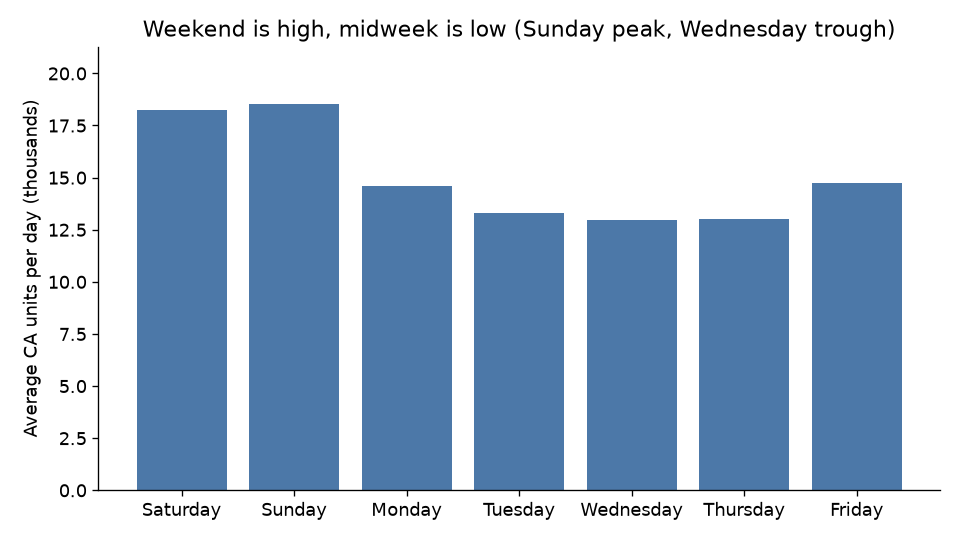
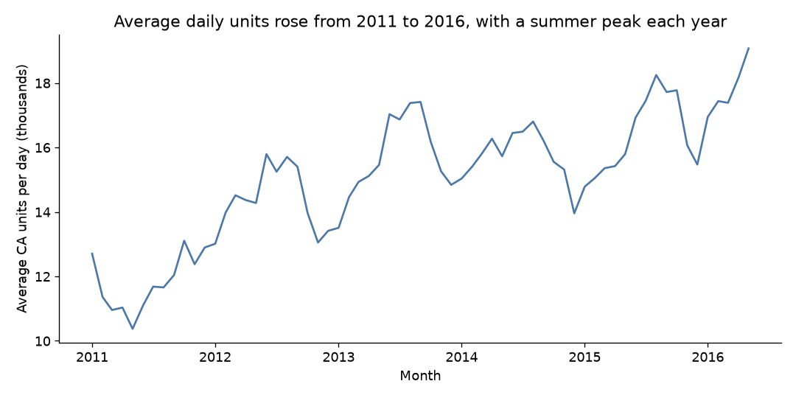
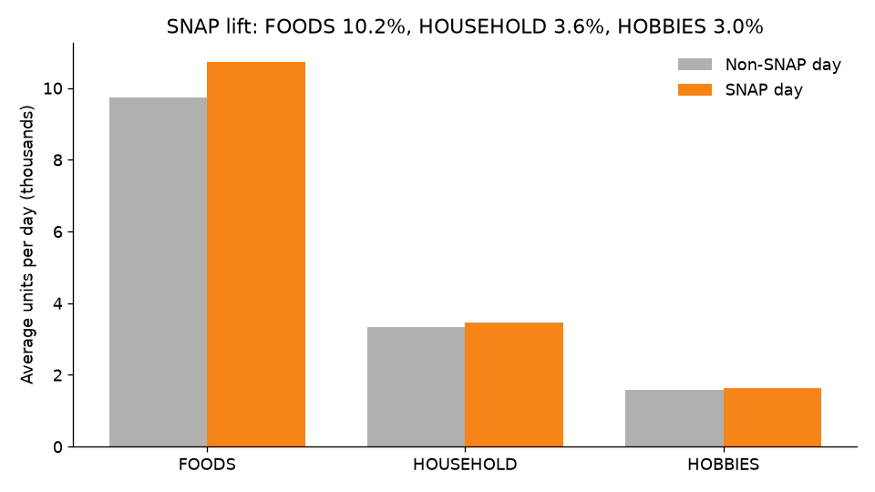
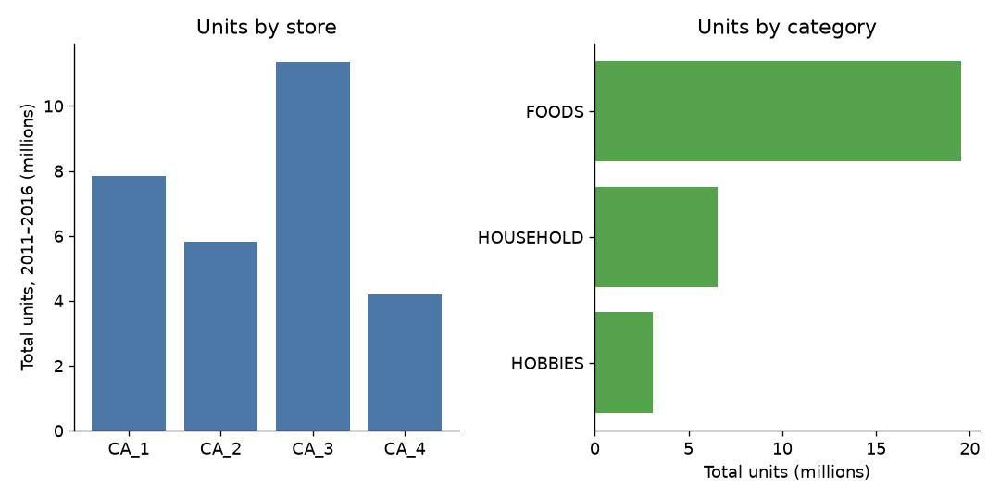

# Analyze — California demand (Walmart M5)

PACE stage: **Analyze**. This page describes the California slice of the M5 files, and it deliberately goes no further. It fits neither LightGBM, nor Prophet, nor the lag-28 baseline, and it reports no forecast score; those belong to Construct.

The checks below are the ones [the plan](01-plan.md) said Analyze would confirm, followed by a recommendation on the grain at which Construct should begin. Every figure comes from `src/analyze_ca.py`, run on the local raw files rather than a fresh download. Summary tables live in `data/processed/`, charts in `images/`, and the raw CSVs stay git-ignored.

## What was checked

The work filters `sales_train_evaluation` to `CA_1`, `CA_2`, `CA_3` and `CA_4`, then joins each `d_` column to `calendar.csv` to recover the date, weekday, Walmart week and `snap_CA`. It compares the overlap with `sales_train_validation`, and it measures zeros, weekday shape, the monthly level, SNAP, store and category volume, and whether `sell_prices` covers those item-store-weeks. No model is fit.

## 1. Shape

| Check | Result |
|---|---|
| Item–store series | **12,196** |
| Distinct items | **3,049**, and the same 3,049 in each of the four stores |
| Other California stores | None. `state_id` is only `CA`. |
| Day columns | `d_1` through `d_1941` (**1,941** days) |
| `d_1` | **2011-01-29**, Saturday, Walmart week 11101 |
| `d_1941` | **2016-05-22**, Sunday, Walmart week 11617 |
| Missing day cells | **0** of 23,672,436 |
| Zero-sale cells | **15,621,951** of 23,672,436 (**0.6599215644727058**) |
| Series that never sell | **0** |
| Cells before the series' first sale | **5,149,759** (0.32964890236821254 of all zero cells) |
| Total CA units | **29,196,717** (average **15,042.100463678516** units per day) |
| Validation vs evaluation on `d_1`–`d_1913` | **0** mismatched cells across all 12,196 series |

The plan expected 3,049 × 4 = 12,196 series, and that is exactly what the filter returns. The validation file holds the same history with the last 28 days removed: on the overlapping days, the two files agree exactly once rows are matched on `item_id` + `store_id` (the `id` suffix is `_evaluation` in one file and `_validation` in the other).

A zero, however, is not one thing — and treating it as one would be to the detriment of every score that follows. Some zeros are days before the item was listed; as the price check below shows, those weeks carry **0** units. Others are days after listing on which the item simply did not sell. Still others fall on Christmas, which is a near-shutdown rather than a demand observation, as discussed below. The file does not say which of the remaining zeros were stockouts; accordingly, this stage does not call every zero a demand zero.

No date has a zero total across all four stores together. Christmas comes closest, and even it is not clean:

| Date | Weekday | CA_1 | CA_2 | CA_3 | CA_4 | State total |
|---|---|---:|---:|---:|---:|---:|
| 2011-12-25 | Sunday | 0 | 7 | 1 | 0 | 8 |
| 2012-12-25 | Tuesday | 0 | 2 | 4 | 0 | 6 |
| 2013-12-25 | Wednesday | 0 | 2 | 3 | 0 | 5 |
| 2014-12-25 | Thursday | 0 | 6 | 0 | 0 | 6 |
| 2015-12-25 | Friday | 0 | 2 | 4 | 0 | 6 |

`CA_1` and `CA_4` record 0 on all five Christmas days, `CA_2` never has a store-total of 0, and `CA_3` is 0 only on 2014-12-25. Those five days are not why the zero share stands at 0.6599215644727058. They are, however, reason enough not to read December 25 as ordinary demand.

## 2. Weekly seasonality

The table below averages the **statewide daily total** by weekday. Walmart's week starts on Saturday (`wday` 1), and the span contains 278 Saturdays and Sundays and 277 of each other weekday.

| Weekday | Days | Total units | Average units per day |
|---|---:|---:|---:|
| Saturday | 278 | 5,068,641 | 18,232.521582733814 |
| Sunday | 278 | 5,145,010 | 18,507.230215827338 |
| Monday | 277 | 4,040,743 | 14,587.519855595669 |
| Tuesday | 277 | 3,680,138 | 13,285.696750902527 |
| Wednesday | 277 | 3,586,412 | 12,947.335740072202 |
| Thursday | 277 | 3,598,892 | 12,992.38989169675 |
| Friday | 277 | 4,076,881 | 14,717.981949458484 |

Sunday is the peak and Wednesday the trough, with Sunday's average running **1.4294238279885783** times Wednesday's. Against the all-days average of 15,042.100463678516, Sunday sits at 1.2303620934134774 and Wednesday at 0.8607398794693302. Saturday belongs with Sunday rather than with midweek, while Friday and Monday form the shoulders.

The same shape appears when the statewide daily total is correlated with itself: **0.8408696097678586** at a lag of 7 days, and **0.84399231729513** at a lag of 28 days. Given that lag 28 is exactly four weeks, it lands on the same weekday, and on the state total it loses nothing of the weekly pattern relative to lag 7. That is the descriptive fact behind the baseline. Note, though, that it is not a fitted model, and that it describes the aggregate series rather than each individual item.

## 3. Trend

All four stores record positive units on 2011-01-29 and on 2016-05-22, so no store opens inside the file in a way that would masquerade as a level break. That said, the level still moves. The table below shows average units per day by year; 2011 starts on January 29 and so has 337 days, while 2016 ends on May 22 and so has 143 days.

| Year | Days | Total units | Average units per day | Change in average vs prior year |
|---|---:|---:|---:|---:|
| 2011 | 337 | 3,943,802 | 11,702.676557863502 | — |
| 2012 | 366 | 5,268,487 | 14,394.773224043716 | +0.230041106653613 |
| 2013 | 365 | 5,733,801 | 15,709.043835616438 | +0.09130193238317119 |
| 2014 | 365 | 5,748,876 | 15,750.345205479452 | +0.0026291460062879413 |
| 2015 | 365 | 5,967,138 | 16,348.323287671234 | +0.03796603022921352 |
| 2016 (through May 22) | 143 | 2,534,613 | 17,724.566433566433 | +0.08418252573541074 vs full-year 2015 |

The early climb, from 2011 to 2013, is the obvious shift, whereas 2013 to 2014 is almost flat. The fairer reading of 2016 sets January–April against January–April of 2015, so that a partial May is not compared with a full one. Those months come to 2,114,986 units over 121 days in 2016 (average 17,479.22314049587) against 1,818,718 units over 120 days in 2015 (average 15,155.983333333334), a change of **+0.1532886224579646**. The holdout, in other words, sits on that higher level.

Within each year, the monthly pattern repeats: summer runs higher and winter lower. In 2015, August averages 18,247.483870967742 units per day and January 14,783.387096774193 (August / January − 1 = 0.23432361958170134). December is the weak month, and Christmas falls inside it. January 2011 has only 3 days in the file — a short month, not a demand crash.

The implication for a forecast, even without fitting one, is straightforward: a method that copies 2011 will sit too low. Lag-28 avoids that mistake, because for the holdout it copies 2016-03-28 through 2016-04-24, which already sits on the 2016 level. A model that learns only a single global mean, by contrast, will smear the summer peak into the spring holdout.

## 4. SNAP

`snap_CA` is on for the **1st through the 10th of every month** in this date range, and off otherwise. That yields 64 months × 10 days = **640** SNAP days against **1,301** non-SNAP days. January 2011 lacks days 1–10 because the file starts on January 29; those days are absent from the data rather than non-SNAP.

Average statewide units per day:

| | Days | Average daily units | Total units |
|---|---:|---:|---:|
| SNAP | 640 | 15,823.4234375 | 10,126,991 |
| Non-SNAP | 1,301 | 14,657.74481168332 | 19,069,726 |

The SNAP average is higher by a lift of **0.07952646473197889** (15,823.4234375 / 14,657.74481168332 − 1). Moreover, that lift is far from evenly shared:

| Category | SNAP average daily units | Non-SNAP average | Lift |
|---|---:|---:|---:|
| FOODS | 10,733.3828125 | 9,735.970791698694 | **0.1024460777606011** |
| HOUSEHOLD | 3,463.5203125 | 3,342.5165257494236 | 0.03620140269117922 |
| HOBBIES | 1,626.5203125 | 1,579.2574942352037 | 0.02992724013488668 |

Food moves; household and hobbies barely do. A California model that drops `snap_CA`, or that substitutes `snap_TX` / `snap_WI`, will deposit that food miss on the first ten days of every month. The holdout itself contains 10 consecutive SNAP days: **2016-05-01 through 2016-05-10**.

## 5. Intermittency, and why that hurts MAPE

Here, "sells on a day" means units greater than zero, and a series counts as intermittent if it sells on fewer than half of days.

| Slice | Series | Fewer than half of all 1,941 days | Share | Fewer than half of days after the first sale | Share | Median share of days with a sale, after first sale |
|---|---:|---:|---:|---:|---:|---:|
| All CA | 12,196 | 9,145 | 0.7498360118071499 | 7,679 | 0.6296326664480157 | 0.40610295109545236 |
| FOODS | 5,748 | 3,826 | 0.6656228253305497 | 2,951 | 0.5133959638135004 | 0.4916002360078755 |
| HOUSEHOLD | 4,188 | 3,374 | 0.8056351480420249 | 2,918 | 0.6967526265520535 | 0.3460161398387375 |
| HOBBIES | 2,260 | 1,945 | 0.8606194690265486 | 1,810 | 0.8008849557522124 | 0.250778842449923 |

Admittedly, listing timing explains part of this; it is not, however, the whole story. Even after each series' own first sale, 7,679 of 12,196 series (share 0.6296326664480157) still sell on fewer than half of the remaining days. The median series is positive on 0.29314786192684184 of all days, and on 0.40610295109545236 of days after it starts. Hobbies form the thin end, with the median hobby series positive on about a quarter of days after its first sale. Foods, meanwhile, sit closer to a coin flip than to a series that sells every day.

By category, the zero share of cells is **0.6010612476548077** for FOODS, **0.6924089926961899** for HOUSEHOLD and **0.7494223395476285** for HOBBIES.

MAPE divides the absolute miss by the actual, so on a zero-actual day the ratio is undefined. Those days account for 15,621,951 of 23,672,436 item-store-days, which means a MAPE that silently drops them scores only the minority of days, while a MAPE that keeps them explodes. When the actual is 1 unit, a miss of 1 unit is a 100% error; when the actual is 2, the same miss is 50%. An intermittent series can therefore post a terrible MAPE on a small unit miss, while a series that sells every day posts a modest MAPE on a much larger one. That is why the plan scores MAPE only on positive-actual days, prints the share of days excluded, and sets WAPE (sum of absolute errors over sum of actual units, zeros included) beside it. This stage still computes none of those scores; it explains why they were specified as they were.

## 6. Store differences

Each store carries the same 3,049 items. Volume, however, does not match.

| Store | Total units | Share of CA units | Zero-cell share |
|---|---:|---:|---:|
| CA_3 | 11,363,540 | 0.3892060877940489 | 0.5939976772986101 |
| CA_1 | 7,832,248 | 0.26825783186513746 | 0.6375904870964695 |
| CA_2 | 5,818,395 | 0.19928250837243106 | 0.6881029058437417 |
| CA_4 | 4,182,534 | 0.14325357196838262 | 0.7199951876520017 |

`CA_3` sold 11,363,540 / 4,182,534 = 2.717137667848483 times as many units as `CA_4`, and the smaller store is also the more intermittent one, with a zero-cell share of 0.7199951876520017. A single model can be fit across stores; that said, any score not broken out by store will mostly describe `CA_3`.

## 7. Category mix

The item id begins with the category, and `cat_id` sits on the row. There are three categories, and nothing else.

| Category | Series | Total units | Share of CA units | Zero-cell share |
|---|---:|---:|---:|---:|
| FOODS | 5,748 | 19,535,863 | 0.6691116333387758 | 0.6010612476548077 |
| HOUSEHOLD | 4,188 | 6,565,267 | 0.22486319266649055 | 0.6924089926961899 |
| HOBBIES | 2,260 | 3,095,587 | 0.10602517399473373 | 0.7494223395476285 |

Food accounts for two-thirds of the units. Within food, department `FOODS_3` alone contributes **14,106,481** units — **0.48315298600181655** of all California units, from 3,292 series. `HOBBIES_2` marks the small end, with 218,242 units, a share of 0.007474881508081885 of the state and a zero-cell share of 0.8827517470064901.

## 8. Price coverage

`sell_prices` holds one row per `item_id`, `store_id` and `wm_yr_wk`; it is not a daily price. For California alone:

| Check | Result |
|---|---|
| CA price rows | **2,708,822** |
| Stores present | **4** (CA_1 through CA_4) |
| Duplicate item–store–week keys | **0** |
| Null prices | **0** |
| Price weeks | **11101 through 11621** |
| Sales weeks (`d_1`–`d_1941`) | **11101 through 11617** (278 weeks) |
| Series with no price row at all | **0** |
| Series whose first price week is after 11101 | **7,681** of 12,196 |
| Series with a price on the last sales week (11617) | **12,196** of 12,196 |
| Item–store–weeks in the sales span | **3,390,488** (12,196 × 278) |
| Of those, with a price | **2,660,038** (coverage **0.7845590369291973**) |
| Before the series' first price | **730,450** |
| Interior holes (missing week between first and last price) | **0** |
| Weeks after the last price but still inside the sales span | **0** |
| Price rows on weeks outside the sales span | **48,784** = 12,196 × 4 |
| Units sold on days before the first price week | **0** |

The uncovered share, 730,450 / 3,390,488 = 0.2154409630708028, is entirely "not listed yet." Once a price appears, every later sales week carries one, which means there is nothing to interpolate inside an active item's history. Days before the first price contribute **0** units, so the gap coincides with the leading zeros rather than concealing sales. The 48,784 extra rows are the four Walmart weeks after `d_1941` (11618–11621), one row per CA series; they are the unpublished horizon's prices sitting in the file, and they are not used here.

Construct may use price as a feature for any week in which the row exists. It should not, however, fill a pre-listing week with a later price and then treat that week as though the item had been on the shelf. Those weeks have no sales.

## Holdout calendar

The last 28 day columns form the test window the plan named, and the calendar confirms it rather than leaving it assumed:

- `d_1914` to `d_1941`: **2016-04-25 (Monday) through 2016-05-22 (Sunday)**.
- Events inside the window: Pesach End (2016-04-30), Orthodox Easter (2016-05-01), Cinco de Mayo (2016-05-05) and Mother's Day (2016-05-08).
- SNAP: 2016-05-01 through 2016-05-10 (10 days).
- Walmart weeks: **11613** has 5 days (Monday–Friday, partial), **11614–11616** have 7 days each, and **11617** has 2 days (Saturday–Sunday, partial).

A weekly executive table that sums 11613 or 11617 and calls the result a week will understate volume. The daily score uses all 28 days either way. The partial weeks should be marked; the days should not be dropped.

## Worked lag-28 example (definition only)

The baseline the plan specified is illustrated here on one fast series, so that the copy is not a string of zeros: `FOODS_3_090` at `CA_3`, the highest-unit item within the Excel pair recommended below.

The holdout day `d_1914` (2016-04-25, a Monday) sold **133** units. Its lag-28 forecast is the actual on `d_1886` (2016-03-28, also a Monday): **61** units. The source day lies inside training, given that `d_1913` is the last training day. The same shift covers the other 27 holdout days, and the pairs are recorded in `data/processed/ca_lag28_example.csv`. This is the definition made visible to a reviewer. It is not a score, and one item's 133-versus-61 day is no evidence that the baseline fails; scoring it is the work of Construct.

## Recommendation for Construct

Construct should prove the pipeline on **FOODS at CA_3** before fitting all 12,196 series. Food accounts for 19,535,863 of 29,196,717 CA units (share 0.6691116333387758), and CA_3 is the largest store; together, that pair comes to 1,437 item–store series and **7,625,660** units (share 0.2611821048236348 of the state), with only **one** day on which the category–store total is zero — 2014-12-25. It is also the Excel workbook pair: one category, one store, and a daily total that genuinely shows the weekly shape. `FOODS_3`, with 14,106,481 units and a share of 0.48315298600181655 of CA, offers a smaller cut should even 1,437 series prove too heavy for a first debugging pass. HOBBIES, by contrast, is the wrong place to start: 1,945 of 2,260 of its series (share 0.8606194690265486) sell on fewer than half of days, so a bug in the zero handling would be invisible.

The decision grain remains item–store–day for all four stores, rolled up bottom-up; the first grain to *build* is FOODS, not a separate weekly model. Lag-28 is the right naive baseline. Sunday averages 18,507.230215827338 units against Wednesday's 12,947.335740072202, and the state total correlates 0.84399231729513 with itself 28 days later against 0.8408696097678586 at lag 7, so the four-week copy preserves the weekday on which the plan relied. Finally, `snap_CA` should stay on the feature list for food, partial Walmart weeks should not be scored as full weeks, and pre-listing price weeks should be left empty.

Construct and Execute are, by design, not done in this file. What this stage offers instead is a measured starting point: the slice, the baseline and the pitfalls are now known before a single model is trusted.
