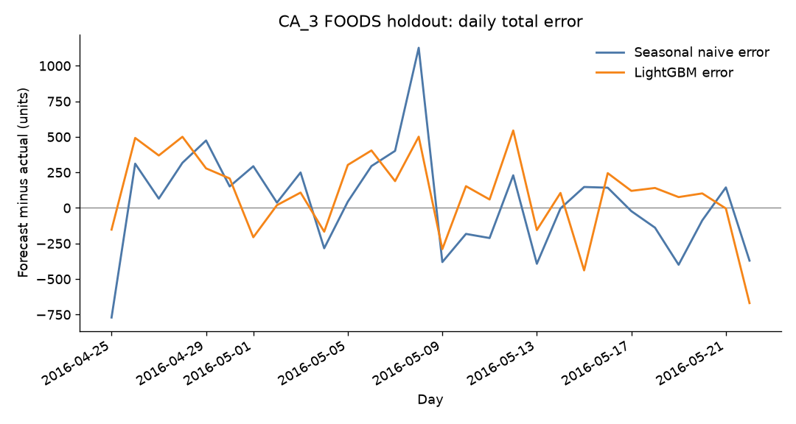

# Construct — FOODS at CA_3, 28-day forecast

PACE stage: **Construct**. This page fits the seasonal-naive baseline and a single LightGBM model, then scores both on the holdout. It is neither the executive report nor a Tableau dashboard; those belong to Execute.

Every figure below comes from one run of `src/construct_forecast.py` on the local raw files. The metrics sit in `data/processed/ca3_foods_metrics.csv`, the row-level forecasts in `data/processed/ca3_foods_holdout_predictions.csv`, and the raw CSVs stay git-ignored.

## What was built

The scope is the cut Analyze recommended, and the plan's rules still apply in full:

- **Series:** FOODS at store CA_3 only — **1,437** items, one series each. The script halts if that count is anything other than 1,437.
- **Target:** daily unit sales.
- **Holdout:** `d_1914` through `d_1941`, that is, **2016-04-25 (Monday) through 2016-05-22 (Sunday)**, or 28 days. The script confirms the window from `calendar.csv` rather than assuming it.
- **Training labels:** `d_1` through `d_1913` only. The first target day with every sales feature filled is `d_56`, given that a 28-day rolling window ending at lag 28 reaches back 55 days.
- **Baseline:** seasonal naive, lag-28. Each holdout day's forecast is that item's actual from 28 days earlier — the same weekday, four weeks back. For this horizon, the source days are `d_1886` through `d_1913`, the 28 days immediately preceding the holdout, so no holdout actual is used.
- **Stronger model:** LightGBM, direct multi-step, with one pooled model for all 1,437 items, fit with `lightgbm.train` (native API, LightGBM 4.7.0). It is neither a separate model per item nor a recursive forecast.

Outputs:

| File | What it is |
|---|---|
| `src/construct_forecast.py` | The fit, the scores, the chart, the one-item workbook |
| `data/processed/ca3_foods_holdout_predictions.csv` | 40,236 rows: `item_id`, `day`, `actual`, `baseline`, `lgbm` |
| `data/processed/ca3_foods_metrics.csv` | MAPE, WAPE, bias overall and by weekday |
| `images/ca3_foods_forecast_vs_actual.png` | Daily total actual vs both forecasts |
| `images/ca3_foods_daily_error.png` | Daily total (forecast − actual) for both models |
| `reports/ca3_foods_one_item_forecast.xlsx` | Highest-volume item, baseline vs LightGBM |

40,236 = 1,437 × 28.

## Why these features

Sales features are restricted to lags of 28 or more. At a 28-day horizon, yesterday's units are not yet known, which means they cannot enter the model.

| Feature | What it is | Why it is here |
|---|---|---|
| `lag_28` | Units on the same weekday four weeks before the target day | The seasonal-naive forecast itself, and the most recent same-weekday actual that is always already observed 28 days ahead |
| `lag_35` | Same weekday five weeks back | A second week so one odd week is not the whole story |
| `lag_42` | Same weekday six weeks back | A third point on the weekly cycle, still outside the horizon |
| `roll_mean_7_ending_lag28` | Mean of the 7 days ending on the lag-28 day | The latest fully known week, next to the single lag-28 point |
| `roll_mean_28_ending_lag28` | Mean of the 28 days ending on the lag-28 day | A month of level, shifted with the target day |
| `wday` | Walmart weekday of the target day (1 = Saturday … 7 = Friday), categorical | Known from the calendar before the day arrives. Analyze: Sunday is the peak and Wednesday is the trough |
| `month` | Month of the target day, categorical | Known ahead. Carries the within-year level without using a future sales total |
| `snap_CA` | 1 on California SNAP days (the 1st–10th) | Known ahead. Analyze: food moves more than household or hobbies on these days. The holdout includes 2016-05-01 through 2016-05-10 |
| `event_flag` | 1 if `event_name_1` or `event_name_2` is filled | Known ahead. One flag, not one column per holiday |
| `sell_price` | Price of this item at CA_3 for the Walmart week that contains the target day | From `sell_prices` when that week has a row. A price can change demand. It is not a sales lag |

`wday` and `month` are categorical, so that the tree does not treat Saturday (1) as "less than" Friday (7).

There is no `item_id` column; each series' level enters through its own lags instead. On the refit model, gain ranked the features in this order: `roll_mean_28_ending_lag28`, `roll_mean_7_ending_lag28`, `lag_28`, `sell_price`, `month`, `lag_42`, `lag_35`, `wday`, `snap_CA`, `event_flag`. The event flag was barely used. That said, the ranking describes this particular fit; it is not a claim that events never matter.

Holdout prices were complete, with a missing share of 0.0. Weeks before an item is listed stay missing in training rather than being filled with a later price.

## Leakage rule

A sales feature for target day `t` may use units from day `t − k` only when `k ≥ 28`. Both rolling means **end** on the lag-28 day, so neither includes lags 1–27. Those short lags would sit inside the horizon of a forecast made 28 days ahead — precisely the leak this rule exists to prevent.

The forecast is direct multi-step rather than recursive: the same columns are filled for all 28 holdout days from history that ends on `d_1913`. The newest sales day any holdout feature reads is the lag-28 day of `d_1941`, which is `d_1913`, and the script raises an error should that check fail. The holdout `lag_28` column is, moreover, checked against the sales matrix shifted by 28.

Calendar fields describe the target day's own calendar, and the price is the target week's price. Neither is computed from sales inside the horizon.

Holdout actuals never serve as training labels. The tree count is chosen on an earlier slice that also precedes the holdout: `d_1886` through `d_1913`, with 2,629,710 training rows before that slice and 40,236 rows within it. Early stopping watches L2 on that slice with a patience of 40 rounds and a cap of 400 trees. The log's best iteration was **82**, with a reported validation L2 of **12.2367**. The scored model is a refit of **82** trees on every feature-complete day from `d_56` through `d_1913`, early-stopping slice included. The holdout enters neither fit.

The remaining settings were fixed before the holdout score was seen: objective regression (L2), learning rate 0.05, 63 leaves, `min_child_samples` 100, bagging fraction 0.8 on every tree, feature fraction 1, seed 42. Predictions below 0 are clipped to 0, and this run clipped **0** of 40,236 holdout predictions.

Lags 1–27 are neither built recursively nor used.

## Metrics

The definitions apply to item-days — not to the daily total, and not averaged per item first:

- **MAPE** = mean of `|forecast − actual| / actual` on item-days with **actual > 0**. A zero actual leaves that ratio undefined, so such days are excluded from MAPE alone.
- **WAPE** = sum of `|forecast − actual|` / sum of actual. Zeros stay in. This is the volume-weighted score, in which a high-unit miss moves the result more than a one-unit miss does.
- **bias** = sum of `(forecast − actual)` / sum of actual. A positive value means the forecast is high in total units; a negative value means it is low.

The ratios are not multiplied by 100: a WAPE of 0.6490765893903951 means the absolute miss equals that share of actual units.

The holdout contains **109,870** actual units across **40,236** item-days. Of those, **25,302** have actual > 0 and enter MAPE, while the other **14,934** are zeros, excluded from MAPE only. Each weekday occurs 4 times in a 28-day window, so each weekday row covers 1,437 × 4 = **5,748** item-days.

### Overall

| Model | MAPE (actual > 0) | WAPE | bias | Sum of absolute error | Sum of (forecast − actual) |
|---|---:|---:|---:|---:|---:|
| Seasonal naive (lag-28) | 0.8781250159967809 | 0.777000091016656 | 0.010694457085646673 | 85369.0 | 1175.0 |
| LightGBM | 0.5633893484087068 | 0.6490765893903951 | 0.02570857287913414 | 71314.04487632272 | 2824.600902230468 |

**LightGBM beat the baseline on WAPE and on MAPE.** WAPE, note, is the volume-weighted comparison the plan asked for, and absolute error fell from 85,369 units to 71,314.04487632272 units.

**LightGBM did not, however, win on bias.** Both forecasts run high in total, and the gap is undeniable: the baseline is high by 1,175 units (bias 0.010694457085646673), LightGBM by 2,824.600902230468 units (bias 0.02570857287913414). A lower absolute error with a higher total is still an over-forecast; it is no reason to treat the model as unbiased.

MAPE runs far larger than WAPE for both models because it is an unweighted mean over item-days, many of which are small counts. A miss of 1 unit on a day that sold 1 unit is a 100% MAPE error. MAPE, therefore, should never lead a conversation with a manager.

### By weekday

Seasonal naive:

| Weekday | MAPE | WAPE | bias | Sum of actual |
|---|---:|---:|---:|---:|
| Saturday | 0.9038168575803124 | 0.7404011461318052 | 0.03965616045845272 | 17450.0 |
| Sunday | 0.8947266209591159 | 0.7615560403033136 | 0.062065025449257294 | 19254.0 |
| Monday | 0.8357941037396879 | 0.7619767723203484 | -0.058855552867166705 | 16532.0 |
| Tuesday | 0.8948828623649565 | 0.8120019402674797 | 0.0245305245651722 | 14431.0 |
| Wednesday | 0.8619867906459328 | 0.7925210259261833 | -0.03961910057690971 | 14387.0 |
| Thursday | 0.8548711126061935 | 0.8066721767225186 | 0.01427605379818168 | 13309.0 |
| Friday | 0.8972921328169511 | 0.7812090714827324 | 0.01978355276762942 | 14507.0 |

LightGBM:

| Weekday | MAPE | WAPE | bias | Sum of actual |
|---|---:|---:|---:|---:|
| Saturday | 0.5822511863899636 | 0.6123337887666629 | 0.028438249412784875 | 17450.0 |
| Sunday | 0.556940026195429 | 0.6045699016113305 | -0.04232832418464977 | 19254.0 |
| Monday | 0.5340876252178307 | 0.6301648779761346 | -0.010851997940360798 | 16532.0 |
| Tuesday | 0.5617469947963659 | 0.6613556460970794 | 0.0604199005560734 | 14431.0 |
| Wednesday | 0.5595251243429415 | 0.6776249150704433 | 0.02783930193481845 | 14387.0 |
| Thursday | 0.5717487870844438 | 0.7102066377808693 | 0.10688316420335713 | 13309.0 |
| Friday | 0.5783375936476854 | 0.6772863093573736 | 0.04327542424589884 | 14507.0 |

LightGBM's WAPE is lower on every weekday; its bias, however, is not. Thursday is the high side (bias 0.10688316420335713), and Sunday the low side (bias -0.04232832418464977), whereas the baseline's Sunday bias is positive (0.062065025449257294). Sunday is also the highest-unit weekday in this window, with 19,254 actual units.

## One item in Excel

`reports/ca3_foods_one_item_forecast.xlsx` covers **FOODS_3_090**, department **FOODS_3**, store **CA_3**. It was chosen as the FOODS item at CA_3 with the highest sum of units on `d_1` through `d_1913` — **250,502** training units — and holdout units played no part in the choice. The holdout then sold **3,357** units, with all 28 days positive.

The workbook holds the 28 holdout days (actual, lag-28 and LightGBM), a line chart, the 28 source days the baseline copies (`2016-03-28` through `2016-04-24`) and this item's scores. Its first holdout day matches the worked example in Analyze: on **2016-04-25** the actual was **133** and the lag-28 baseline **61**, the latter being the actual on 2016-03-28. LightGBM forecast **81.73313553207025** for that day.

Scores on this item alone, from the Item metrics sheet:

| Model | MAPE | WAPE | bias | Sum of absolute error | Sum of (forecast − actual) |
|---|---:|---:|---:|---:|---:|
| Seasonal naive | 0.2028302705195178 | 0.1974977658623771 | -0.07953529937444147 | 663 | -267 |
| LightGBM | 0.1945756276869436 | 0.2129970073026922 | -0.1505686355631554 | 715.0309535151379 | -505.4589095855129 |

**On this item, LightGBM loses on WAPE.** The baseline's absolute error is 663 units, against LightGBM's 715.0309535151379, although LightGBM's MAPE is slightly lower. Both forecasts run low here, and LightGBM runs lower (bias -0.1505686355631554 versus -0.07953529937444147). The aggregate win, then, is not a win on the busiest series, given that the pooled model is pulled by the other 1,436 items.

## What the charts show

The lines are sums across all 1,437 items rather than a single item, and both forecasts keep the weekend peak. The baseline's largest daily miss in this window falls on Sunday **2016-05-08**: actual **4,327**, baseline **5,453** (error **+1,126**) and LightGBM **4,827.5309141213** (error **+500.5309141213**). LightGBM's largest shortfall comes on the last day, Sunday **2016-05-22**: actual **5,069**, LightGBM **4,399.3233688866** (error **-669.6766311134**) and baseline **4,698** (error **-371**).

The error chart plots daily total forecast minus daily total actual, so a point above zero marks a day on which the forecast was high. It covers the same 28 days; it is not a new model.

## What Execute should say to a manager

Execute should say this, and no more than this:

On food at CA_3, for the 28 days ending 2016-05-22, a LightGBM model beat a same-weekday-four-weeks-ago copy on volume-weighted absolute error, with a WAPE of 0.6490765893903951 against 0.777000091016656. The absolute miss was 71,314.04487632272 units against 85,369 units, on 109,870 units actually sold. Both forecasts came out high in total — the copy by 1,175 units, LightGBM by 2,824.600902230468 units. Lower absolute error, after all, is not the same thing as an unbiased forecast.

MAPE on days that sold at least one unit was 0.5633893484087068 for LightGBM and 0.8781250159967809 for the copy. It looks worse than WAPE because small item-days count as much as large ones, and because the 14,934 of 40,236 item-days that sold nothing are left out of MAPE.

The busiest item, FOODS_3_090, is the exception already measured: on that series, the four-week copy had the lower WAPE (0.1974977658623771 versus 0.2129970073026922). A buyer should therefore not be told that the model is better on every item.

This is one category, one store and one 28-day origin. It is not a score for the other California stores, nor for household or hobbies, and no dollar saving, service-level change or safety-stock cut should be attached to these ratios. Whether the remaining unit error is small enough to change a replenishment buffer is a later decision (inventory is project 02), and it is not answered here.

Execute may show the daily chart and the metrics table. It should neither refit the model nor widen the scope on the executive page.

## What this file does not claim

The limits below are stated plainly, so that the result is read for what it is:

- No dollar impact is claimed; none was calculated.
- LightGBM is not claimed to be unbiased; its bias is positive overall.
- LightGBM is not claimed to win on the highest-volume item; on WAPE, it does not.
- Nothing is claimed about CA_1, CA_2, CA_4, HOUSEHOLD or HOBBIES, since those series were not fit.
- The early-stopping slice (`d_1886`–`d_1913`) sits inside the refit, so the tree count was chosen on days the final model also trains on. The holdout played no part in that choice. This limits how clean the tree count is; it is not a leak of holdout actuals.

Taken together, the result is a genuine but bounded improvement: lower volume-weighted error on one slice, with a modest over-forecast that Execute should report alongside it.
