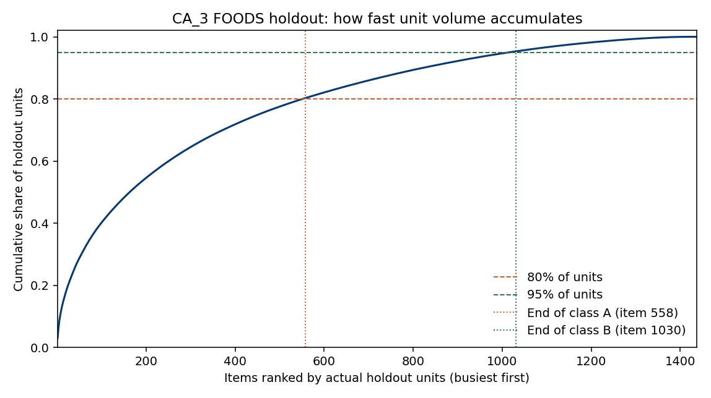
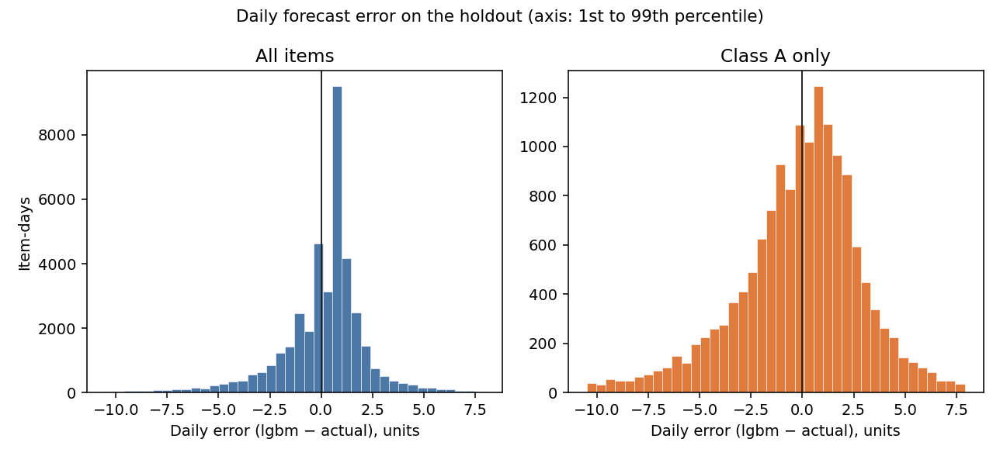

# Analyze — CA_3 FOODS inventory (volume and forecast error)

PACE stage: **Analyze**. This file applies the class rule the plan already decided and measures how far the planning forecast sits from the units that actually sold. It computes no reorder point, no safety stock, no order quantity, no EOQ, no Solver solution and no simulation; those belong to Construct. The ten decisions at the end of [01-plan.md](01-plan.md) are not reopened, and the project README, still the template, is not filled here.

The page proceeds in order: what was counted, how the classes were cut, how large the forecast misses are, and what is still missing before anyone sizes a buffer.

## What was counted

The sole input is `01-demand-forecasting/data/processed/ca3_foods_holdout_predictions.csv`, which I checked directly rather than reusing a rounded figure from the plan. Its columns are `item_id`, `day`, `actual`, `baseline` and `lgbm`, and it has no missing values. The grid is complete — **1,437** items, **28** days, **40,236** rows — and the days run **2016-04-25 through 2016-05-22** without gaps. Every measure on the file is daily unit sales.

The planning forecast is **`lgbm`**, and `actual` is what sold. `baseline` is the seasonal naive from Project 1, retained here only so that the comparison can be recomputed on the same rows. `actual` is not treated as the demand a buyer expected on 2016-04-24.

`sell_price` was not opened. The shelf price is what the shopper paid, not what the unit cost the retailer, and there is no holding-cost rate with which to turn a price into a cost of holding. Ranking items by units times price, or scoring a miss in dollars, would therefore invent that cost; ABC is accordingly ranked on actual holdout units. The objective stays in units. Dollar savings will not be claimed.

## How the classes were cut

The plan's rule is cumulative unit volume, not a headcount chosen in advance. Items are ranked by actual holdout units, highest first. **Share** is an item's units divided by all holdout units (**109,870**), and **cumulative share** is the running sum of those shares in rank order. Ascending `item_id` merely orders the file when two items have the same unit count; it is not a rank.

**Class A** is every item with at least as many holdout units as the first item whose cumulative share reaches 80%. That item is included, because stopping one item earlier would leave the class short of 80%. Every other item with the same unit count is included too, given that splitting the tie would let `item_id`, rather than units, decide who is in A. **Class B** applies the same rule to what remains — the next volumes until the cumulative share reaches 95%, plus the whole tie at that volume — and **Class C** is whatever is left. B, in short, is the next slice to 95%; C is the rest. None of it is ranked on retail value.

The counts and unit shares are in `data/processed/abc_class_summary.csv`.

| Class | Items | Share of items | Holdout units | Share of units |
|---|---:|---:|---:|---:|
| A | 558 | 0.3883089770354906 | 88,230 | 0.8030399563120051 |
| B | 472 | 0.32846207376478775 | 16,486 | 0.15005005916082642 |
| C | 407 | 0.28322894919972164 | 5,154 | 0.04690998452716847 |
| All | 1,437 | 1 | 109,870 | 1 |

558 + 472 + 407 = 1,437. 88,230 + 16,486 + 5,154 = 109,870.

Class A is not a small set — and that is the pivotal fact of this stage. It takes **558** items, a share of items of 0.3883089770354906, to reach a unit share of 0.8030399563120051. That is a long list. The curve in the chart climbs quickly at the left, since the busiest item alone holds 0.030554291435332667 of units, and then keeps climbing through 558 items before class A is complete. This category, in short, is not held by a handful of SKUs.

The 80% line is crossed inside a tie, which is why the class does not stop at exactly 80%:

- `FOODS_3_825` is the last item with 50 units, at a cumulative share of 0.7999180850095567; without the next item, the class would still fall short of 80%.
- `FOODS_1_044` is the first item whose cumulative share reaches 80%, with 49 units and a cumulative share of 0.8003640666241922.
- Seven items have 49 units, and all seven are class A. The last of them, `FOODS_3_819`, reaches a cumulative share of 0.8030399563120051, which is the class A unit share in the table. Placing the later 49-unit items in B would have let `item_id` draw the line.

The 95% line is cut the same way:

- `FOODS_2_092` is the first item whose cumulative share reaches 95%, at 0.9501592791480841, with 23 units.
- Twenty-one items have 23 units, and all twenty-one are class B. The last class B item is `FOODS_3_705`, at a cumulative share of 0.9530900154728316.
- Class C begins at the next lower volume. Sixteen items in `abc_classes.csv` have holdout units of 0, and they sit in C.



The chart ranks items from busiest to slowest. The horizontal lines mark 80% and 95% of units, while the vertical lines mark the last class A item (item 558) and the last class B item (item 1,030). The vertical lines sit slightly past the horizontal ones because the tie at each cutoff stays in its class.

## The busiest items

These ten head `abc_classes.csv`, which is sorted by actual holdout units, and all ten are class A. Cumulative share runs from the start of the ranking, not from within the ten.

| Item | Holdout units | Share | Cumulative share |
|---|---:|---:|---:|
| FOODS_3_090 | 3,357 | 0.030554291435332667 | 0.030554291435332667 |
| FOODS_3_586 | 1,883 | 0.017138436333849094 | 0.04769272776918176 |
| FOODS_3_120 | 1,617 | 0.014717393282970784 | 0.062410121052152545 |
| FOODS_3_252 | 1,405 | 0.01278784017475198 | 0.07519796122690452 |
| FOODS_3_681 | 1,253 | 0.011404387002821516 | 0.08660234822972604 |
| FOODS_3_288 | 993 | 0.00903795394557204 | 0.09564030217529808 |
| FOODS_3_555 | 907 | 0.008255210703558752 | 0.10389551287885683 |
| FOODS_3_587 | 876 | 0.007973059069809775 | 0.1118685719486666 |
| FOODS_3_714 | 870 | 0.007918449076180941 | 0.11978702102484755 |
| FOODS_3_282 | 745 | 0.006780740875580231 | 0.1265677619004278 |

After ten items, the cumulative share is still only 0.1265677619004278. The plan listed the first five as context and said they were not the assortment; they still are not. Class A is the 558 items above, not these ten.

## Forecast error

Daily error is **`lgbm` minus `actual`**, so a positive error means the planning forecast sat above the units sold that day. The reverse subtraction would make a high forecast look negative, contradicting the way the plan speaks of bias. The bias is not subtracted out of `lgbm` before these scores; the forecast is used as-is.

**Bias in units** is the sum of those daily errors over the scope, and **bias share of units** is that sum divided by the scope's actual units, with a positive value meaning the forecast is high in total. **WAPE** is the sum of absolute daily errors divided by the scope's actual units, zeros included — the Project 1 definition. **MAE** is the mean absolute daily error, in units per item-day, with each item-day counted once. **Daily error std** is the sample standard deviation of the signed daily error, divisor n - 1, pooled across the item-days in the scope; it says how far one day's forecast sits from that day's actual. Note that it is not the uncertainty of demand over the lead time.

Per item, the same definitions appear in `data/processed/forecast_errors.csv`: `n_days` (28 for every item), `sum_actual`, `sum_lgbm`, `bias` (the item's sum of daily errors), `mae` and `daily_error_std` (that item's own 28-day sample standard deviation). The scope rows are in `data/processed/forecast_error_summary.csv`.

On the whole file:

| | Value |
|---|---:|
| Item-days | 40,236 |
| Sum of actual | 109,870 |
| Sum of lgbm | 112,694.60090223046 |
| Sum of absolute error | 71,314.04487632272 |
| Bias, units | 2,824.6009022304675 |
| Bias share of units | 0.025708572879134136 |
| WAPE | 0.6490765893903951 |
| Baseline sum of absolute error | 85,369 |
| Baseline bias, units | 1,175 |
| Baseline WAPE | 0.777000091016656 |
| Baseline bias share of units | 0.010694457085646673 |

WAPE is 71,314.04487632272 / 109,870, and that division is the WAPE cell. MAE divides the same absolute-error sum by 40,236 item-days, giving 1.7723939973238572 units per item-day. On these same rows, the baseline still has the higher WAPE. Recomputing from the prediction file reproduces the Project 1 overall scores — LightGBM WAPE of 0.6490765893903951 against a baseline WAPE of 0.777000091016656, and a high bias share of 0.025708572879134136. The plan's "about 2.6%" and "64.9% versus 77.7%" are this row.

Class A, however, points the other way.

| | Class A |
|---|---:|
| Items | 558 |
| Item-days | 15,624 |
| Sum of actual | 88,230 |
| Sum of lgbm | 83,209.44203074832 |
| Sum of absolute error | 45,331.53096709876 |
| Bias, units | -5,020.5579692516685 |
| Bias share of units | -0.05690307116912239 |
| WAPE | 0.5137881782511478 |

Class A WAPE is 45,331.53096709876 / 88,230. The bias share is negative: on the items that hold 0.8030399563120051 of units, `lgbm` runs low, not high. The file-level high bias is simply the sum of the class biases, which do not share a sign.

| Class | Bias, units | Bias share of units | WAPE |
|---|---:|---:|---:|
| A | -5,020.5579692516685 | -0.05690307116912239 | 0.5137881782511478 |
| B | 1,778.581176105778 | 0.10788433677700947 | 0.934024688966281 |
| C | 6,066.577695376358 | 1.1770620285945592 | 2.053586124743081 |
| All | 2,824.6009022304675 | 0.025708572879134136 | 0.6490765893903951 |

The three class bias figures add up to the overall bias of 2,824.6009022304675. Class C holds 0.04690998452716847 of units yet carries a large high miss, which means a single file-level bias does not describe the items for which a reorder point would be written. That said, the decision still stands: `lgbm` is used as-is, and no bias is removed before the holdout scores a policy. This stage does not debias.

## How wide the daily misses are

Width here is measured in units per day rather than as a share of units. A class can have a lower WAPE and yet a wider unit miss, because WAPE divides by that class's actual units, and the busier class has more units in the denominator.

Across all item-days, MAE is **1.7723939973238572** units, an average pulled up by large misses; the median item's own MAE is 1.2111919520686334. The pooled daily error std is **3.3218300151666726** units, against a median item's own daily error std of 1.4632669382855612. The middle item-day carries a signed error of 0.618029332215945, so on a typical row the forecast sits above actual. The share of item-days with a positive error is 0.6136047320807237, and the share with a negative error 0.38639526791927625. Most rows, then, are high by a fraction of a unit; the total unit bias, however, is the sum, not that typical row.

The full range of daily error runs from -81.7256057103582 to 59.76535018683266. The histogram draws the 1st through 99th percentile of all-item daily error, -10.501677550789527 to 7.9119620265669734, so that the body stays readable. The two tails are nonetheless real: they appear in the summary file, even though they fall off the axis.

On class A, the unit misses are wider. MAE is **2.9014036717293115** units per item-day, with a median class A item MAE of 2.095686704570066, and the pooled daily error std is **4.956011585658703** units, with a median class A item daily error std of 2.559781664213147. The middle class A item-day still runs slightly high, at a median error of 0.1578817775207484, and the share of class A item-days with a positive error is 0.5231694828469022 against 0.4768305171530978 negative. The unit-weighted bias is negative all the same, because the large misses point down; indeed, the extremes of the whole file, -81.7256057103582 and 59.76535018683266, are class A days. The class A 1st and 99th percentiles are -16.95884306555385 and 10.566661774472289.



The two panels share the horizontal scale but not the vertical one, since class A has fewer item-days and a shared count axis would flatten it. Positive marks a day on which the forecast was above actual.

## Seven days, as a description only

Lead time is the plan's assumption of **7 days** — one number, fixed. The file carries neither a lead time nor any lead-time variability, and nothing in this stage estimates one.

Lead-time demand uncertainty is **not** the daily standard deviation above. After all, a 7-day miss is the sum of seven daily misses. Those days are not treated as independent, and the daily std is not multiplied by the square root of 7. Neither spread is turned into a safety stock, and there is no service factor on this page.

What was computed is narrower. The 28 holdout days divide into four non-overlapping blocks of 7, recorded in `data/processed/seven_day_blocks.csv`:

| Block | Start | End | Days |
|---|---|---|---:|
| 0 | 2016-04-25 | 2016-05-01 | 7 |
| 1 | 2016-05-02 | 2016-05-08 | 7 |
| 2 | 2016-05-09 | 2016-05-15 | 7 |
| 3 | 2016-05-16 | 2016-05-22 | 7 |

Overlapping windows were avoided, since they would count the same days more than once. For each item and block, the 7-day error is the block's sum of `lgbm` minus its sum of `actual`. The standard deviation below is the sample standard deviation of those block errors, divisor n - 1. It describes how wide a 7-day total miss was on this holdout; it is not a policy.

| Scope | Item-blocks | Mean 7-day error | Std of 7-day error | MAE of 7-day error |
|---|---:|---:|---:|---:|
| All items | 5,748 | 0.49140586329688013 | 16.062537649296544 | 7.073907657846068 |
| Class A | 2,232 | -2.2493539288761952 | 23.97165769861511 | 11.874513689478032 |

5,748 is 1,437 items times 4 blocks, and 2,232 is 558 times 4. The all-item mean runs high, whereas the class A mean runs low, by 2.2493539288761952 units per item per block, in the same direction as the class A daily bias. The class A 7-day std, 23.97165769861511, is wider than the all-item 7-day std. These are descriptions of this window — neither a reorder point nor a safety stock.

The same blocks also describe demand over 7 days, which is not an order quantity. Overall, the mean 7-day sum of `lgbm` is 19.6058804631577 units per item-block, against a mean 7-day actual of 19.11447459986082; on class A, the mean 7-day sum of `lgbm` is 37.280215963596916, against a mean 7-day actual of 39.52956989247312. Construct's order quantity is 7 days of each item's own `lgbm`, in units — not these averages, and not a cost optimum. It is not computed here.

## What is still missing

Moreover, there is still no unit cost, no holding-cost rate and no order cost. `sell_price` is not a stand-in, and no cost-to-price ratio is applied. There is no on-hand position, there are no receipts, and there is no supplier history, while the 7-day lead time remains an assumption. Dollar savings will not be claimed.

Construct is the next stage. It builds the reorder point and the safety stock, sets the order quantity to 7 days of `lgbm` in units, and checks policies through simulation. The constraint it will test is a unit fill rate under 5%, with cycle service level and the day-level stockout rate reported beside that cap rather than replacing it. Among the policies that stay under the cap, the objective is units held, and Solver may change safety stock only. Review is continuous, and unmet demand is lost sales. The forecast stays as-is, including the class A low bias measured above. None of that is calculated in this file.

## What this stage does not do

This stage produces no reorder point, no safety stock, no simulation and no fill rate; no EOQ, no Solver model and no service factor. It does not scale the daily standard deviation into a lead-time buffer, it does not debias, and it attaches no dollar cost. Dollar savings will not be claimed. What it does establish is the ground Construct must stand on: a long class A list, and a forecast that runs low exactly where volume is concentrated.

## How to reproduce

From the repo root:

```bash
python 02-inventory-optimization/src/analyze_inventory.py
```

| Output | What it is |
|---|---|
| `src/analyze_inventory.py` | The counts and the charts |
| `data/processed/abc_classes.csv` | One row per item, busiest first |
| `data/processed/abc_class_summary.csv` | Item counts and unit shares by class |
| `data/processed/forecast_errors.csv` | Per-item bias, MAE, and daily error std |
| `data/processed/forecast_error_summary.csv` | Overall and class A, B, and C |
| `data/processed/seven_day_blocks.csv` | The four 7-day windows |
| `images/abc_cumulative_share.png` | Cumulative unit curve |
| `images/daily_forecast_error_hist.png` | Daily error, all items and class A |
