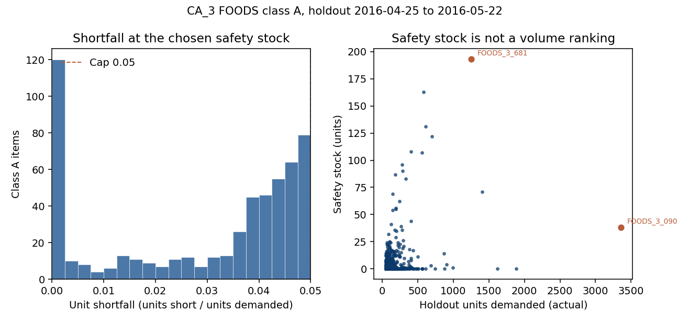

# Construct — CA_3 FOODS inventory (reorder point and safety stock)

PACE stage: **Construct**. This file builds the reorder point and the safety stock the plan already defined, then scores them on the holdout. It does not reopen the ten decisions at the end of [01-plan.md](01-plan.md), and class A remains the 558 items from [02-analyze.md](02-analyze.md). The forecast is neither refit nor debiased, and the project README, still the template, is not filled here.

The page proceeds in order: the simulation, the safety-stock search, the class A totals, and the one item a reader can open in the workbook.

## What was counted

The demand file is the one Analyze used: `01-demand-forecasting/data/processed/ca3_foods_holdout_predictions.csv`. The class cut is recomputed with the Analyze functions rather than retyped from the class file, giving a class A of **558** items and **88,230** holdout units over the days **2016-04-25 through 2016-05-22**.

Signed error is still **`lgbm` minus `actual`**. On class A, that bias comes to **-5,020.5579692516685** units, a share of units of **-0.05690307116912239**; the forecast on these items runs low. The figure is reproduced here so that the reorder point is not built on a different error; it is not, however, subtracted from `lgbm`. The plan's decision stands: the forecast is used as-is.

`sell_price` was not opened. There is still no unit cost, no holding-cost rate and no order cost, so the objective stays in units. Dollar savings will not be claimed.

## What the columns mean

`fill_rate` in `data/processed/policy.csv` is **units short divided by units demanded**, and the cap requires that ratio to be **strictly under 0.05**; an exact 0.05 fails. Note that this is the unfilled share — the plan's definition of a unit fill rate under 5% — and not the fraction of units sold, which is one minus this ratio.

A day counts as stocked out when its units short exceed zero. A **cycle** is a day on which one or more lots were ordered, and it runs from that day through the day before the next order, or through 2016-05-22 if it is the last order. A stockout on the order day itself counts, because the order placed that day arrives seven days later. `cycles_with_stockout` counts the cycles that contain a stockout day.

`avg_on_hand` is the mean end-of-day on-hand over the 28 days, after demand and lost sales. `cycle_stock_units` is the order quantity divided by two — the textbook half-batch, not the objective.

## How a day runs

Lead time is **7 days**, fixed, and an assumption, since the files carry neither a lead time nor any lead-time variability. An order placed on day t becomes available at the start of day t+7, before that morning's review and before that day's demand; it cannot, therefore, serve the day on which it was ordered. A receipt moves units from on-order to on-hand, so the inventory position — on-hand plus on-order — does not change when a receipt lands. Unmet demand is lost: it is neither subtracted as a backorder nor allowed to deepen the position.

Because the data are daily, continuous review is approximated by two looks within each day:

1. In the morning, before demand, if the position is at or under the reorder point, the smallest number of lots is ordered that lifts the position strictly above the reorder point. That means one lot when the position equals the reorder point, and a second lot when one lot would land exactly on the reorder point, because the rule orders at `<=`.
2. Demand is the day's `actual`, and sales are the minimum of on-hand and actual, so on-hand never goes negative.
3. After demand, if the position is back at or under the reorder point, further lots are ordered the same day. They too arrive on day t+7, and they do not refill units already lost.

Across class A, **136** item-days placed more than one lot. The second look, then, is not idle, even though most order days still involve a single lot.

## Starting inventory

There is no on-hand history, and none was invented from the month before the holdout.

On the morning of **2016-04-25**, on-hand equals the reorder point and on-order is zero. The first review falls that same morning, and since the position already sits at the reorder point, the first order is placed before any holdout demand. From then on, on-order is no longer zero. The opening phrase "on-order none" describes the balance before the review, not a refusal to order on day 0. Every class A item orders on day 0, and the first receipt arrives on the morning of **2016-05-02**.

The window is 28 days, and that starting point is part of the result — a limitation worth stating plainly. The shelf begins at the reorder point rather than empty, and the first week is covered only by that opening balance. A different opening balance would change both the shortfall and the average on-hand; other openings were not tried.

## Order quantity and expected lead-time demand

For each item, `mean_daily_lgbm` is the mean of that item's 28 `lgbm` values, and expected lead-time demand is that mean times 7. Because the forecast varies by day, this is the mean day multiplied by the lead time — neither the sum of one particular week nor `actual`.

The order quantity is the smallest whole number of units that is at least that expected lead-time demand, and at least 1: `math.ceil` on a positive number, equivalent to Excel's `ROUNDUP(x, 0)`, so an exact integer stays as it is. It is not an EOQ, and the search does not change it.

The reorder point is expected lead-time demand plus the integer safety stock, and it is not rounded. On-hand can therefore sit on a fraction of a unit, given that the forecast mean is not an integer, and units short can likewise be fractional when the shelf holds a fraction and the day's demand is larger. The cap is applied to that ratio.

## Safety stock

Safety stock is an integer number of units, chosen separately for each item. Two calculations appear on the page so that the search is not a black box; neither one is the policy.

The scale is the item's own 28-day sample standard deviation of daily (`lgbm` − `actual`), the same `daily_error_std` as in Analyze, multiplied by the square root of 7 — the usual independent-days lead-time sigma. The plan said not to treat that product as the policy by itself, and it is not so treated.

Four non-overlapping 7-day blocks do not yield a per-item sigma. Each item has only four block errors, and a sample standard deviation of four points is unstable; nothing here pretends otherwise. What I did compute is the ratio of that four-point standard deviation to the independent-days scale. Its median is **1.0005069444077974**, its mean **1.0620523240049689**, and its 25th and 75th percentiles **0.7162315258311641** and **1.328711418890887**. For the median item, then, the four-block width and the square-root-of-7 scale are the same size, and the spread of the ratio is simply the noise of four points.

The mean of the block variances divided by the mean of (daily variance times 7) is **2.2010449293279675**. That ratio was not applied as a factor. It is pulled up by items whose four weeks are far wider than their daily noise, and scaling every item by 2.2 would pad the typical item on account of that tail. The wide items instead receive whatever integer the simulation requires, and the others are not scaled up to match them.

Lag correlations of the daily error, averaged across the 558 items, sit near zero: **0.031181120390307154** at lag 1, then **0.0030323280216445502**, **-0.021846458696928986**, **-0.004837583353715764**, **0.004856937716273669**, **-0.017346099121796823** and **0.015922062872085828** at lag 7. The median lag-1 correlation is **0.016914040466102682**. Adjacent days are thus weakly dependent, which supports the square root of 7 as a description of a typical item's scale. That said, it does not make the scale the reorder-point policy; the cap is a simulated unit shortfall, not a normal quantile.

The candidate built on that scale is the normal-loss solution, and it is rejected wherever the simulation says so. Let σ_L be the daily error standard deviation times the square root of 7. The standard normal loss is n(z) = φ(z) − z(1 − Φ(z)), the textbook backorder identity sets n(z) = 0.05 × order quantity / σ_L, and safety stock = z × σ_L. I solved for z by bisection. If z is not positive, the candidate is 0; if it is positive, the candidate is that product, ceiled to an integer. The formula assumes normal lead-time demand, an unbiased forecast, backorders and a long run of cycles, and this holdout offers none of those: class A `lgbm` runs low, unmet demand is lost, and a typical item sees only a handful of cycles.

The candidate was simulated anyway, so that its miss is a count rather than a suspicion. On **186** items, the candidate's unit shortfall was not under 0.05, so on those 186 the search used a higher safety stock. On **314** items, the search used a lower safety stock than the candidate, and on **58** items the two are the same integer; 186 + 314 + 58 = 558. The candidate safety stocks sum to **3,012**, whereas the safety stocks actually used sum to **4,079**. The median candidate is 4 units; the median policy is 2. The formula, in short, under-buffers the items the low forecast hurts and over-buffers a larger number of smaller misses. Given that the cap applies per item, the over-buffered items cannot repair the 186 misses — which is why the candidate is not the policy.

For the example item, the candidate z is **-0.16203597071870773**, so its candidate safety stock is 0: the order quantity is large relative to σ_L, and the formula concludes that no buffer is required. Simulating that zero yields a shortfall of **0.16327516455060415**, so the search raises it. The forecast mean is not adjusted before that test.

## The search

For each item, safety stock steps through the integers 0, 1, 2 and so on, up to a bound that cannot stock out on this finite series, namely an opening on-hand at least equal to the sum of the item's actual demand. That bound is only a bound, not a recommended buffer.

A value is feasible when units short / units demanded is strictly under 0.05. The objective is average end-of-day on-hand, and the feasible value with the lowest average on-hand is kept. A tie closer than 1e-8 breaks toward the smaller safety stock, so that a tie never adds a unit.

On all 558 items, the lowest average on-hand coincided with the smallest feasible integer, and `n_items_chosen_above_min_ss` is **0**; the search never kept an extra unit past the cap. Where a shortfall sits well under 5%, it is either because safety stock 0 already cleared the cap or because the last unit tipped a miss into a much smaller shortfall. It is never because a larger buffer was preferred.

## Class A totals

The summary row is `data/processed/policy_summary.csv`, and the item rows are in `data/processed/policy.csv`, sorted by `item_id`.

| | Class A |
|---|---:|
| Items | 558 |
| Units demanded | 88,230 |
| Units short | 2,681.5674402151976 |
| Unit shortfall (`fill_rate`) | 0.030392921231046102 |
| Total average on-hand | 14,461.064128366881 |
| Total safety stock | 4,079 |
| Total cycle stock (order quantity / 2) | 10,541.5 |
| Textbook units held (cycle stock + safety stock) | 14,620.5 |
| Items missing the cap | 0 |
| Items with safety stock 0 | 193 |

The shortfall is 2,681.5674402151976 / 88,230 = 0.030392921231046102. That is the cap metric, and it sits under 0.05; one minus it, 0.9696070787689539, is the share of units sold. No class A item missed the cap. The highest item shortfall, **0.049946516104229** on `FOODS_2_266`, is still under 0.05.

The objective that was minimized item by item sums to **14,461.064128366881** units of average on-hand, while the textbook expression — half the order quantity plus safety stock — sums to **14,620.5**. The two are close on this window, yet they are not the same number. The search used the simulation, and the textbook expression is reported so that the difference stays visible. Neither number is a dollar holding cost.

**193** items clear the cap at safety stock 0, and the other **365** need a positive integer. **114** items have a shortfall of exactly 0, and six of those carry a positive safety stock: there, the last unit removed every stockout, which is a step in a discrete search rather than a padded buffer. The median safety stock is 2, the 75th percentile 7, and the maximum **193**, on `FOODS_3_681` rather than on the busiest item. The median item shortfall is **0.038070671837693734**, and among items with a positive safety stock it is **0.04308352428601003**. The mass, in other words, sits near the cap. The unweighted mean of the item shortfalls, **0.029163436585459158**, is pulled down by the zeros.

The five names Analyze listed, read from `policy.csv`, show that the buffer does not follow a volume ranking.

| Item | Units demanded | Order quantity | Safety stock | Reorder point | Unit shortfall |
|---|---:|---:|---:|---:|---:|
| FOODS_3_090 | 3,357 | 713 | 38 | 750.8852726036218 | 0.04978097330842364 |
| FOODS_3_586 | 1,883 | 474 | 0 | 473.8546930978276 | 0.010698516676671493 |
| FOODS_3_120 | 1,617 | 435 | 0 | 434.0506172848497 | 0.04016659413429209 |
| FOODS_3_252 | 1,405 | 272 | 71 | 342.45635833336723 | 0.049497253855254636 |
| FOODS_3_681 | 1,253 | 230 | 193 | 422.7964730863048 | 0.04964367670685971 |

`FOODS_3_586` is the second-busiest item, yet its safety stock is 0; `FOODS_3_681` is fifth, and its safety stock is 193. `FOODS_3_681`'s `lgbm` summed to 919.1858923452189 against 1,253 actual, a gap of 333.8141076547811 units. The reorder point was not handed that gap as a debiased mean. Instead, the simulation placed 193 units on the safety stock, because that is the only decision the search may change, and 193 is the smallest integer that brings this item's shortfall under 0.05.



The left panel shows the unit shortfall at the chosen safety stock, with the dashed line at 0.05. The bar at zero holds the items that never stocked out, and the rest pile up against the cap — exactly what a search that stops at the first feasible integer should produce. The right panel plots safety stock against holdout units, with `FOODS_3_090` and `FOODS_3_681` labeled. A bigger item does not mean a bigger buffer.

## What was reported beside the cap

The cap is the unit shortfall. The two measures below are not substitutes for it, and one of them does not clear 5%.

Day-level stockout rate: **722** item-days had a shortfall, out of 558 × 28 = 15,624, a rate of 722 / 15,624 = **0.046210957501280084**. It falls under 0.05 on this window, but it was neither the constraint nor a target of the search.

Cycle stockout share: **601** of **2,819** cycles had a stockout, a share of 601 / 2,819 = **0.21319616885420362**, which is not under 0.05. The textbook cycle service level, the share of cycles with no stockout, is **0.7868038311457963** — not 95%. A policy that meets the unit cap on this file, therefore, does not meet a 5% cycle-stockout cap. The plan said not to swap the two; this is precisely the case it was warning about.

Moreover, the window cannot show a stable cycle service level. The median item has **4** cycles and the mean **5.051971326164875**, with a minimum of **1** (one item) and a maximum of **27**, and **295** items have four cycles or fewer. A share built on four cycles is, in truth, a count. It is still reported, but the cap that was enforced is the unit shortfall.

## FOODS_3_090

This is the busiest class A item and the live sheet in the workbook. From `policy.csv`: mean daily `lgbm` **101.84075322908883**, expected lead-time demand **712.8852726036218**, order quantity **713**, safety stock **38**, reorder point **750.8852726036218**, units short **167.11472739637816**, units demanded **3,357**, shortfall **0.04978097330842364**, days stocked out **3**, cycles **5**, cycles with a stockout **2**, average on-hand **345.9080843935039**, cycle stock **356.5**.

The item's `lgbm` sums to 2,851.5410904144874 against an actual of 3,357, so the forecast runs low by 505.45890958551263 units over the 28 days. Safety stock is 38, not 505, and the mean was not corrected. Whenever the position hits the reorder point, another lot of 713 goes on order, and that pipeline is what replaces units; the 38 is the extra on the reorder point that the cap demanded on top of that rule.

The opening on-hand is the reorder point, 750.8852726036218, and the first receipt arrives on 2016-05-02. The first seven days of actual sum to **904**, and since the opening balance cannot cover 904, the item stocks out before the first receipt even with a safety stock of 38. Those seven `lgbm` values sum to 733.7686219100218, which is not the planning expectation; that expectation remains the mean week, 712.8852726036218.

The shortfall falls on three days: 2016-04-30, 2016-05-01 and 2016-05-13. Orders go out on day indexes 0, 5, 12, 18 and 25, one lot each, and two of the five cycles contain a stockout. The cycle stockout share on this item is thus 2/5, while the unit shortfall sits just under 0.05. Same item, different score — which is why the cap is the unit shortfall.

A safety stock of 37, the integer just below the choice, leaves units short of 168.1147273963782 and a shortfall of **0.05007885832480732**, which fails the strict cap. Its average on-hand, 345.7295129649324, is a little lower than 345.9080843935039, so the objective would have taken 37 had 37 been feasible; it was not. A safety stock of 0, which is also the normal-loss candidate, yields a shortfall of 0.16327516455060415. The enumeration appears on `Example_search` in the workbook, from 0 through 2,645. The minimum feasible safety stock on that sheet is 38, matching the Python choice, and the minimum average on-hand among feasible rows is the average at 38.

## The workbook

`reports/03-construct-solver.xlsx` has four sheets.

`Example_FOODS_3_090` is the model. Safety stock in B8 is the decision, and average end-of-day on-hand in B11 is the objective, computed by formula from the 28-day simulation beneath it. The shortfall in B14 is units short / units demanded, and the constraint holds that cell strictly under 0.05. The order quantity is `ROUNDUP` of the mean daily `lgbm` times 7, at least 1. A Solver run must change neither the order quantity, the lead time, the forecast nor actual. The named ranges are `SafetyStock`, `AvgOnHand`, `FillRate`, `OrderQty` and `ReorderPoint`.

That sheet was recalculated outside Python. At a safety stock of 38, the largest absolute gap between the formula on-hand and shortfall and the Python trace was 0 at eight decimal places.

`Example_search` is the integer enumeration for this item: values from Python, plus formulas that mark the cap and pick out the minimum feasible safety stock. `Class_A` holds one row per item, with the safety-stock column as the decision and the reorder point, the shortfall, the half-batch and the cap flag computed by formula from the recorded columns. Editing a safety stock on `Class_A` does not, however, rerun 558 simulations. The portfolio objective on that sheet is the sum of average on-hand, and the items-missing-cap formula counted 0 when the sheet was recalculated. `Notes` holds the Solver setup.

Excel Solver was not run. No Solver binary was available, and no Solver answer was invented. The integers are the Python enumeration, written into the decision cells so that the sheet shows the same policy as the CSV.

Anyone who opens Solver on the example sheet should minimize `AvgOnHand` by changing `SafetyStock`, with `SafetyStock` an integer ≥ 0 and the shortfall under the cap. The Solver dialog offers `<=` but not a strict `<`; since the cap is strict, the practical constraint is a shortfall `<= 0.049999`, or else discarding any result that lands on exactly 0.05. The method should be **Evolutionary**, because the simulation is a step function of safety stock. **GRG Nonlinear** assumes a smooth function and can stall on a flat step between integers, and the simplex method does not apply, given that lost sales do not form a linear program. `Example_search` is the integer search Evolutionary would be approximating, already computed.

## What this stage does not do

This stage sets no class B or C policy, does not debias `lgbm`, derives no per-item sigma from four blocks, and treats no service factor as the answer. It computes no EOQ and leaves the order quantity untouched inside the search. It uses no 3-day or 14-day lead time, no lead-time variability, no historical on-hand and no dollar cost. Dollar savings will not be claimed. Nor does it claim that the cycle-stockout share is under 5%; it is 0.21319616885420362. There is no dashboard, no edit to the Project 1 forecast and no edit to the project README. What it does deliver is a class A policy that clears the unit cap on this window, with its weaker cycle-level service stated beside it rather than hidden.

## How to reproduce

From the repo root:

```bash
python 02-inventory-optimization/src/construct_policy.py
```

The script imports `analyze_inventory.py` for the file check, the signed error, the ABC cut and the 7-day blocks. It requires pandas, NumPy, matplotlib and openpyxl.

| Output | What it is |
|---|---|
| `src/construct_policy.py` | The simulation and the integer search |
| `data/processed/policy.csv` | One row per class A item |
| `data/processed/policy_summary.csv` | One row of class A totals |
| `reports/03-construct-solver.xlsx` | Example simulation, the search, and the class A sheet |
| `images/class_a_safety_stock.png` | Shortfall at the chosen safety stock, and safety stock against volume |
