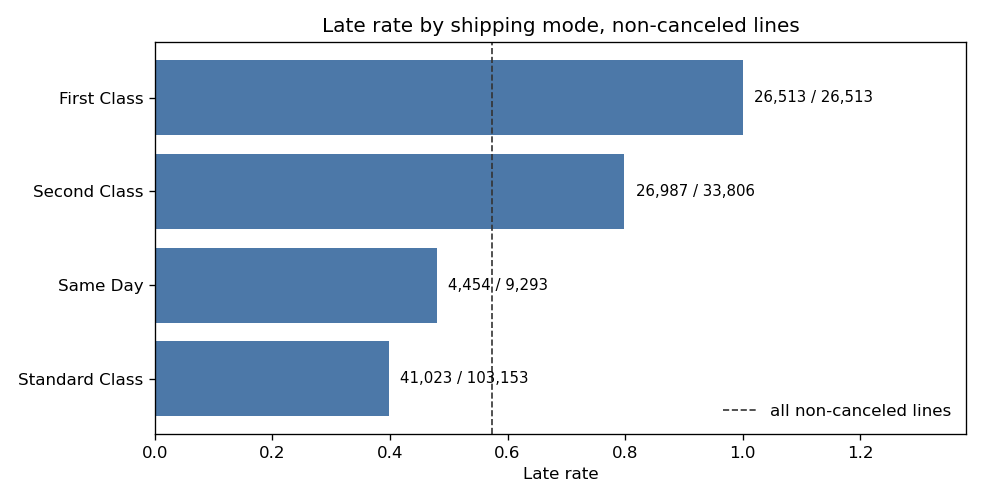

# Business report — late delivery at DataCo

This report is written for a fulfillment lead; the two-minute version is [04-execute.md](04-execute.md). Note what it does not do: it refits no model, sets no threshold, and claims no dollar saving.

## Question

Which orders miss the date the customer was promised, and do those misses sit in a shipping mode, a region, or a product category?

The person who can still change the outcome is the one who sets the shipping promise; a model that scores the line after the mode has already been chosen arrives too late to matter.

## What "late" means

Each row in the file is an order line. The KPI population is every line whose `Delivery Status` is not `Shipping canceled`, given that a cancel neither kept nor broke a delivery promise and therefore has no place in the denominator.

Late means `Late_delivery_risk` = 1. On this population, that flag matches real days greater than scheduled days on every line. On-time is the complement: the line was not flagged late.

| KPI | Definition | Result |
|---|---|---|
| Population | Non-canceled lines | 172,765 |
| Late lines | Flag = 1 | 98,977 |
| On-time lines | Flag = 0 | 73,788 |
| Late rate | Late lines / population | 98,977 / 172,765 = 0.5728996035076549 |
| On-time rate | On-time lines / population | 73,788 / 172,765 = 0.4271003964923451 |
| Schedule slip | Real days minus scheduled days | Median **1** on the pooled lines |

The pooled median is a mixture; it is not the median of any single shipping mode. Lead with the mode table, then, and not with "usually one day late."

## The mode table

The table is sorted by late rate. The line count sits beside the rate for a reason: Standard Class has the most late lines and, at the same time, the lowest rate.

| Shipping Mode | Lines | Late lines | Late rate | Median slip | Scheduled days | Median real days |
|---|---:|---:|---:|---:|---:|---:|
| First Class | 26,513 | 26,513 | 1.0 | 1 | 1 | 2 |
| Second Class | 33,806 | 26,987 | 0.7982902443353251 | 2 | 2 | 4 |
| Same Day | 9,293 | 4,454 | 0.47928548369740664 | 0 | 0 | 0 |
| Standard Class | 103,153 | 41,023 | 0.39769080879858076 | 0 | 4 | 4 |

26,513 + 33,806 + 9,293 + 103,153 = 172,765, and the late lines sum to 98,977.

First Class does not vary at all. The promise is 1 day; delivery takes 2 days on every non-canceled First Class line, so the slip is 1 and the flag is 1. There is no on-time First Class line to be found.

Second Class promises 2 days, yet the median line takes 4, which puts the median slip at 2. Late is 26,987 / 33,806.

Same Day promises 0 days. Its median slip is 0, because the 4,454 late lines are fewer than half of 9,293; when a Same Day line does miss, it misses by one day.

Standard Class promises 4 days, and its median real days are also 4, so the median slip is 0. The typical Standard Class line meets its promise. That said, the mode still accounts for 41,023 late lines, the largest late count in the file, at a rate of 0.39769080879858076.

The same four rows appear in [dashboards/late_delivery_dashboard.html](../dashboards/late_delivery_dashboard.html), which opens in a browser and is built from `data/processed/mode_scorecard.csv`.

## Region and category do not move the rate

Once the shipping mode is fixed, region does not justify a second program.

First Class is late in all 23 regions and all 5 markets. The median slip is 1 day in every region, and the median lead time is 3 days in every region; that median ranks no place above another, because it is simply the pool.

Within a mode, the five markets barely separate. First Class is 1.0 in every market. Standard Class runs from LATAM, at 11,790 / 29,812 = 0.3954783308734738, to Pacific Asia, at 9,459 / 23,630 = 0.4002962336013542. None of those gaps comes close to the gap between First Class (1.0) and Standard Class (0.39769080879858076).

A region-level check asks whether a region's late rate is merely the product of its mode mix. The largest absolute gap between the actual rate and the rate implied by that mix belongs to Canada: actual minus implied is **−0.06522236464088049**, on **907** lines. Moreover, Canada's First Class lines are still all late. That gap is no reason to stand up a regional program. The source table is `data/processed/region_rate_vs_mode_mix.csv`.

Category yields the same negative result. The median slip is 1 for 49 of 50 categories; the exception is Men's Golf Clubs, with 135 / 274 late and a median slip of 0, on 274 lines. The largest categories sit on the overall rate: Cleats is 13,496 / 23,514 = 0.5739559411414477. A category manager who starts with the highest rate, Golf Bags & Carts at 42 / 61, is starting with 61 lines.

## What the models did

On orders held out of training, with 19,722 late lines out of 34,272 test lines, a logistic regression and a random forest that also saw region, category, customer segment, the order's month and weekday, quantity, price, and discount did not beat a baseline that knows only the shipping mode. Test ROC AUC is 0.7383939473457695 for the mode baseline, 0.736119769260069 for the logistic regression, and 0.7347929101103273 for the forest. When each flags the same share of lines (19,613 of 34,272), the mode catches 13,828 late lines, the logistic model 13,790, and the forest 13,762. Inside Second Class, Same Day, and Standard Class, where the flag still varies, the models do not rank late lines. The forest places 0.9308387729436968 of its impurity importance on shipping mode and 0.006610455290712629 on category. The verdict is indisputable: the models lost to the mode rule.

## Recommendation

Fix the First Class promise, or the operation that delivers it. The promise is 1 day, and delivery takes 2 days on every non-canceled First Class line (26,513 / 26,513). Second Class is the other mode to manage, with 26,987 / 33,806 late and a median slip of 2 days. Do not deploy a classifier, and do not set an operating threshold on the logistic model or the random forest; after all, neither beat the shipping-mode baseline.

A dollar penalty for a late day is not in the file, so the dollar impact is not estimated. It would be a mistake to invent one.

## How this was delivered

Plan locked the late definition and ruled out a dollar impact before any rate was computed ([01-plan.md](01-plan.md)). Analyze measured the scorecard without fitting a model ([02-analyze.md](02-analyze.md)). Construct scored the two baselines, the logistic model, and the forest, and stopped short of picking a threshold ([03-construct.md](03-construct.md)). This page states what to do with those results.

Tableau Public is the publishing step, and it was not done here. The extract to upload is `data/processed/mode_scorecard.csv`; this environment cannot sign into a Tableau Public account, and no public Tableau URL exists. The hiring-manager view is therefore the HTML dashboard.
